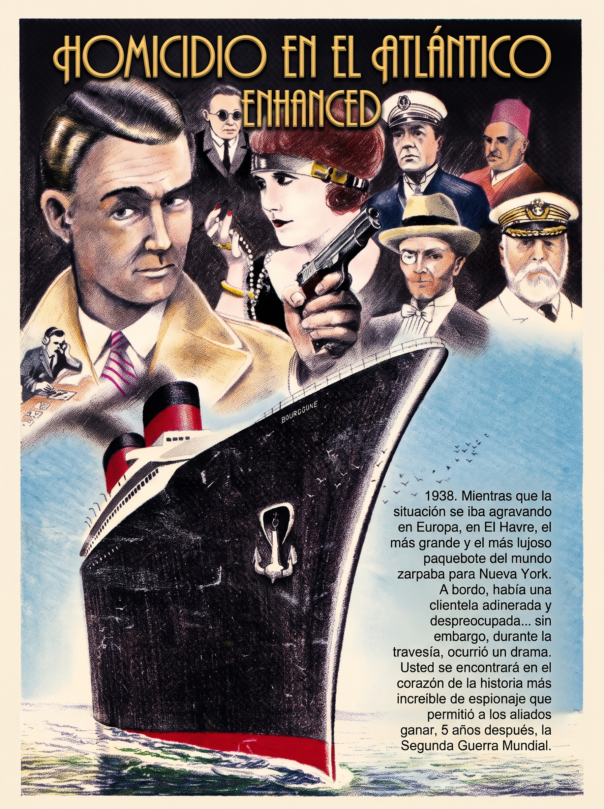
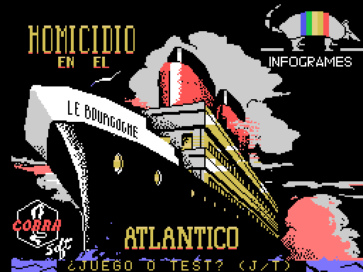
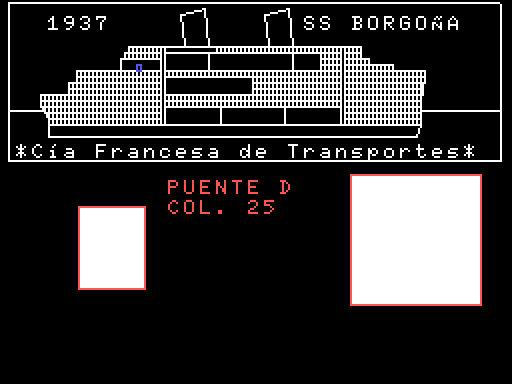
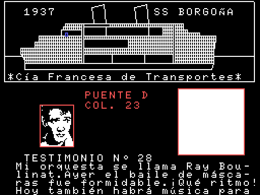
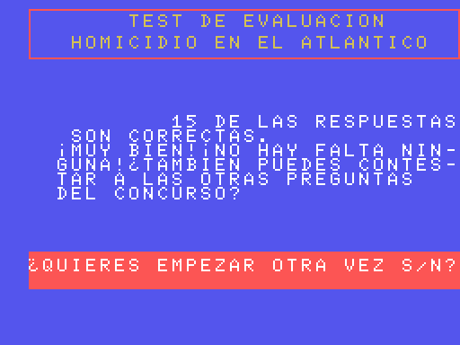

# Homicidio en el Atlántico Enhanced (MSX)

<p align="center"></p>

Versión mejorada de la cinta española de **Homicidio en el Atlántico** (*Meurtres sur l'Atlantique*, Cobra Soft / Infogrames, 1987) para MSX: un cartucho de 64 KB con el juego entero dentro (los 40 testimonios incluidos, sin cara B), con los fallos de la cinta arreglados y con las partes lentas del BASIC pasadas a ensamblador.

La ROM está en [`releases/`](releases/) y en la Release v1.0. Funciona en cualquier MSX con 64 KB de RAM (mapper ASCII16).

## Capturas

| | |
|---|---|
|  |  |
| Título, con «¿JUEGO O TEST?» | El plano ya dibujado y la columna bajo el puente |
|  |  |
| Un testimonio, al momento | El test perfecto con su mensaje |

## Qué tiene de nuevo

**Arreglos sobre la cinta**

- El mensaje morse de la radio se oye entero. En la cinta se cortaba con «ATENCIÓN ERROR DE CASSETTE» en la Ñ de BORGOÑA.
- La maleta dice «NO ES CORRECTO...» cuando fallas la combinación (la cinta decía «CORRECTO...»).
- El test perfecto (15 de 15) tiene su mensaje, como en la versión alemana.
- Una «A» que se quedaba suelta en la columna 0 el resto de la partida tras registrar el cadáver del frigorífico.
- Erratas: DEMASADIO, CONCIENCA, FEMININOS, NON AUTORIZADO y ¡AI!.

**Más cómodo**

- Debajo del puente sale la columna en la que estás («COL. 25»), con la misma numeración que la guía.
- Pantalla de título con «¿JUEGO O TEST? (J/T)», como en el disco francés.
- Los testimonios salen al momento, sin cargar nada de cinta.

**Mucho más rápido**, con la misma lógica del juego (el BASIC original sigue mandando):

| Qué | Cinta | Enhanced |
|---|---|---|
| Dibujo del plano al empezar | 29,7 s | 2,5 s |
| Un paso por el puente | 0,38 s | 0,02 s |
| Ver la sala (V) | 0,66 s | 0,30 s |
| Registrar (I) | 1,34 s | 0,52 s |
| Una página de testimonio | unos 6 s | al momento |

El reloj interno no cambia: Turning sigue apareciendo tras unas 3 h 15 min de espera, como en el original. Todo está explicado en [docs/MEJORAS.md](docs/MEJORAS.md).

## Documentación

- [docs/SOLUCION.md](docs/SOLUCION.md) y [docs/SOLUCION.pdf](docs/SOLUCION.pdf): solución completa, con las respuestas del test (el PDF lleva además el mapa del barco).
- [docs/MEJORAS.md](docs/MEJORAS.md): qué se ha cambiado y cómo está hecho el cartucho.
- [docs/ANALISIS.md](docs/ANALISIS.md): cómo está hecho el juego (ficheros, memoria, rutinas USR, órdenes, reloj).
- [docs/VERSIONES.md](docs/VERSIONES.md): las versiones de MSX (cinta española, disco francés y disco alemán) comparadas.
- [docs/CURIOSIDADES.md](docs/CURIOSIDADES.md): guiños, la caja de pistas, fallos y restos.

## Cómo montarlo

En este repositorio no hay nada del juego original. Para montar la ROM hacen falta las dos caras de la cinta española en formato CAS:

| Cara | Nombre TOSEC | SHA-1 |
|---|---|---|
| A | `Meurtres sur l'Atlantique. Murder on the Atlantic. Homicidio en el Atlantico (1987)(Infogrames)(FR)(es)(Side A)(Game)[!].cas` | `38ac8aa8d9837200f5cb7feb00db4b62b3448887` |
| B | `Meurtres sur l'Atlantique. Murder on the Atlantic. Homicidio en el Atlantico (1987)(Infogrames)(FR)(es)(Side B)(Testimonies)[!].cas` | `d4a2957453debe1d641c3b42ac88f066867c1a3f` |

También hacen falta Python 3 y el ensamblador [pasmo](https://pasmo.speccy.org/) (comprobado con pasmo 0.5.x).

```
python3 rom/build_rom.py ladoA.cas ladoB.cas
```

Deja `rom/HomicidioAtlantico_ES_Enhanced.rom`, idéntica byte a byte a la de `releases/` (SHA-1 `24cc89cff23ae160acba6c972627bae19dd195f6`). Con `--todas` monta además, para comparar, la cinta tal cual en cartucho y la versión arreglada sin acelerar.

El plano del barco va precalculado y comprimido en la ROM: `build_rom.py` lo toma de la ROM de `releases/`. Para rehacerlo desde cero, monta con `--todas`, captura la pantalla con `tools/captura_plano.py` (openMSX) y pásala con `--plano`.

### El desensamblado

`desensamblado/` tiene el código comentado de los binarios de la cinta (ENTETE, TRIMMS y las rutinas USR de MSA). Los datos (gráficos, caras, textos y testimonios) y los programas BASIC no se publican: los saca de la cinta del usuario.

```
python3 desensamblado/build.py ladoA.cas ladoB.cas
```

Vuelve a ensamblarlo todo y rehace las dos cintas en `desensamblado/salida/`, idénticas a las originales.

## Estructura

| Carpeta | Contenido |
|---|---|
| `releases/` | la ROM compilada |
| `rom/` | cargador del cartucho (`cartucho.asm`), rutinas rápidas (`rapida.asm`), cambios al BASIC y montaje |
| `desensamblado/` | ENTETE, TRIMMS y MSA comentados, y `build.py` |
| `tools/` | lectores de CAS, TSX y DSK, detokenizador y tokenizador MSX-BASIC, gráficos, mapa del barco y control de openMSX |
| `docs/` | documentación |

## Créditos

- *Homicidio en el Atlántico* / *Meurtres sur l'Atlantique*: Cobra Soft (guion de Bertrand Brocard, gráficos de Marie-Anne Alison), publicado por Infogrames (cinta española de 1987).
- Enhanced: dirección y pruebas, araubi.
- Desarrollado con Claude (Anthropic).

## Licencia y avisos

- **Herramientas y código nuevo** (`tools/`, `rom/`, `desensamblado/build.py`): [MIT](LICENSE).
- **Desensamblado comentado y documentación** (`desensamblado/`, `docs/`, README): [CC BY-NC-SA 4.0](LICENSE-CC).
- **Juego original y ficheros de `releases/`:** *Homicidio en el Atlántico* es obra de Cobra Soft e Infogrames, y sus derechos son de sus titulares. La ROM de `releases/` contiene el juego original modificado y no está cubierta por ninguna de las licencias anteriores. Esta versión es un homenaje sin ánimo de lucro: no se reclama ningún derecho sobre el original, y los ficheros se retirarán si los titulares lo piden.
- **Portada:** es un homenaje a la carátula original; los personajes y el barco son los del juego.
